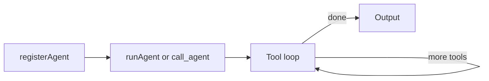

# Agents

## What is an agent?

An agent is an LLM-backed module with:

- A **system prompt** — instructions that define its role and behavior
- **Tools** — Anthropic tool schemas the LLM can call
- An **execute function** — resolves tool calls to results (data or direct message)
- Optional **registration** — so other agents can delegate to it via `call_agent`

## Lifecycle



1. **Registration** — `registerAgent(name, config)` stores config in the registry. Other agents can then delegate via the `call_agent` tool.
2. **Invocation** — Either directly via `runAgent()` or indirectly when another agent calls `call_agent`.
3. **Tool loop** — `runAgent` sends messages to the LLM, receives `tool_use` blocks, calls `executeTool`, appends results, and repeats until no more tools or max iterations.

## Folder structure

Each agent lives in `lib/agents/{agent-name}/`:

| File         | Purpose                                                          |
| ------------ | ---------------------------------------------------------------- |
| `index.ts`   | Registration, exports, main logic                                |
| `prompts.ts` | System prompt(s)                                                 |
| `tools.ts`   | Tool schemas and/or execute logic (or composition of core tools) |

## Setup example

### index.ts

```typescript
import { runAgent } from "@/lib/core/agent";
import { registerAgent } from "@/lib/core/registry";
import { COLLECTOR_SYSTEM } from "./prompts";
import { buildCollectorTools, createCollectorExecuteTool } from "./tools";

const executeTool = createCollectorExecuteTool();

registerAgent("collector", {
  systemPrompt: COLLECTOR_SYSTEM,
  tools: buildCollectorTools(),
  model: "claude-haiku-4-5",
  executeTool,
});

export async function collectData(userInput: string): Promise<string> {
  const result = await runAgent({
    systemPrompt: COLLECTOR_SYSTEM,
    prompt: userInput,
    tools: buildCollectorTools(),
    model: "claude-haiku-4-5",
    executeTool,
  });
  return "message" in result ? result.message : "";
}
```

### prompts.ts

```typescript
export const COLLECTOR_SYSTEM = `You are a data collection assistant.
Ask clarifying questions. When you have enough info, output JSON in <data> tags.`;
```

### tools.ts (core tools only)

```typescript
import { buildTools, createExecuteTool, type ToolSet } from "@/lib/core/tools";

export const COLLECTOR_TOOL_SETS: ToolSet[] = ["db"];

export function buildCollectorTools() {
  return buildTools(COLLECTOR_TOOL_SETS);
}

export function createCollectorExecuteTool() {
  return createExecuteTool(COLLECTOR_TOOL_SETS);
}
```

## Registration and loading

Agents register when their module is loaded. Ensure the agent module is imported somewhere so registration runs — for example, via a handler or API route that uses the agent or one of its exports.

The main entry agent (e.g. conversation) typically does not need to register, since it is invoked directly by the handler rather than via `call_agent`.

Some agents (e.g. ingest) are orchestrators that use `runAgent` for one-off LLM calls (e.g. parsing emails) rather than the full tool-loop pattern. They still follow the folder structure with `prompts.ts` and `tools.ts`.
