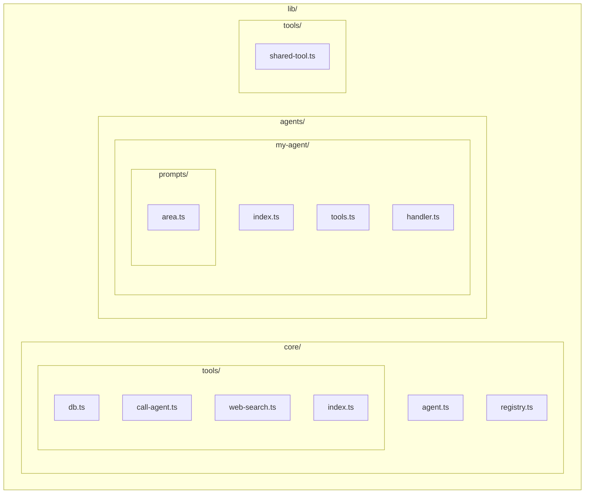

# Structure

## Directory layout

```
lib/
  core/
    agent.ts           # Generic runAgent wrapper (multi-turn tool loop)
    registry.ts        # Agent registration for delegation
    tools/
      index.ts         # buildTools, createExecuteTool, ToolSet
      db.ts            # db_read, db_write
      call-agent.ts    # call_agent (delegate to registered agent)
      web-search.ts    # web_search (Anthropic native)
  agents/
    {agent-name}/
      index.ts         # Registration, exports, main logic
      prompts.ts       # System prompt(s)
      tools.ts         # Tool schemas and/or execute logic
      handler.ts       # Optional: top-level router (not an agent)
  prompts/
    {shared-prompt}.ts # Shared prompts used by lib/tools
  tools/
    {shared-tool}.ts   # Shared helpers used by multiple agents
```

## Diagram



## Responsibilities

| Path                 | Purpose                                                                                                 |
| -------------------- | ------------------------------------------------------------------------------------------------------- |
| `lib/core/`          | Generic agent runtime and built-in tools. No domain logic.                                              |
| `lib/agents/{name}/` | One folder per agent. Each has `index.ts`, `prompts.ts`, `tools.ts` (optional), `handler.ts` (optional) |
| `lib/prompts/`       | Shared prompts used by lib/tools (e.g. area).                                                            |
| `lib/tools/`         | Shared domain tools. Plain functions imported by agents.                                                |
